<div align="center">

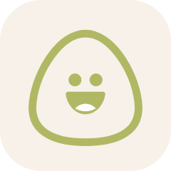

# SoulWake

**An Android alarm that makes you prove you’re up.**
Type a phrase to stop it, answer a check-in, prove your morning with photos, and keep Instagram locked until you do. At night, a buddy PIN stops half-asleep you from switching it off.

*(Formerly First Light. Updating keeps all your data.)*


[**⬇️ Download the APK**](https://github.com/YOUR-USERNAME/soulwake/releases/latest) · [Features](#-features) · [Install](#-install) · [Build it yourself](#-build-it-yourself)

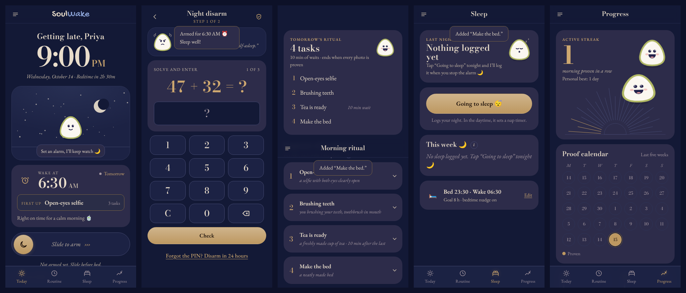

</div>

---

## Why

Most alarm apps lose to the snooze button. Math puzzles and barcode scans don’t help either: you solve them half-asleep in ten seconds and crawl back into bed.

SoulWake spreads the wake-up over **20–30 minutes**. A typed phrase stops the alarm. A surprise check-in five minutes later catches you if you lay back down. Photo tasks with forced waits (brush teeth, then tea ten minutes later) get you out of the room. And the apps you’d scroll in bed stay locked until you’re done. At night, disarming the alarm takes three sums and a friend’s PIN, so 2 a.m.-you can’t quietly cancel it.

## Features

**Waking up**
- ⏰ **Rings with the app closed** and the phone locked, using Android’s own alarm system (the one the Clock app uses). It shows over the lock screen and plays on the alarm volume, so silent mode doesn’t mute it.
- ⌨️ **Type a phrase to stop it.** Letters light up as you type and mistakes turn red. Pasting is blocked.
- 😴 **Limited snooze.** You get two by default, and every one goes in the Hall of Shame.
- 👀 **“Still up?” check-in.** Five minutes later; miss it and the alarm comes back with your punishment song.
- 📸 **Photo-proof tasks.** Live camera only, done in order, with optional waits between them, plus an optional random “chaos” task.
- 🔍 **On-device photo check (optional).** A small CLIP-style model checks each photo matches the task (“a freshly made cup of tea”, not the ceiling), and optionally that it’s in the same spot as your reference photo. One-time download, then offline; photos never leave the phone.
- 🛡️ **Night guard.** From 2 h before bedtime until 2 h after the alarm, disarming or moving it takes 3 sums and your **buddy’s 4-digit PIN** (set by a friend, never shown). Forgot it? A 24-hour wait. In the app, uninstalling or force-stopping SoulWake in those hours takes the same check, then gives you 5 minutes.
- 🔒 **App lock.** Instagram and other apps you choose stay closed until your morning is proven. It unlocks by itself after 1–6 hours, and phone and messages are never locked.

- 🚶 **Step away while you wait.** Leave the task list any time; a pill in the top bar counts down (“⏳ Tea is ready · 7:42”) and you get a notification when it’s time.
- 🧪 **Quick test.** A test alarm stops right after the phrase (“It works!”). “Try the full morning” runs tasks and check-in at 10× speed.

**Music**
- 🎵 Your own songs rotate daily with no repeats. Only the first 40 seconds loop while it rings; the rest plays as a reward.
- 🟢 **Spotify**: one-tap **Connect Spotify** for full songs (Premium, no Client ID to type), or just **Share → SoulWake** on any playlist for 30-second previews with no sign-in. “Play on Spotify” opens the full playlist afterwards.
- ▶️ **YouTube / YouTube Music**: share or paste a playlist. Everything falls back to your songs if it doesn’t start within 8 seconds.
- 🎙️ A voice note from last-night-you, then a motivating clip: your own videos, or **YouTube Shorts and Instagram reels** shared to the app (played in their official embedded players).

**Sleep, without a smartwatch**
- 🌙 **Bedtime nudge** with *Going to sleep / In 30 min / Not tonight*, answered right from the notification.
- 😴 **Naps.** Tap “Going to sleep” in the daytime and Pip asks if it’s a nap, sets a timer (20 min to 4 h), rings you awake, and adds the nap to that day’s sleep.
- 🎯 Any sleep goal from 1 to 12 hours, for tight student schedules (with a kind word, not a lecture).
- 💤 A warm-chime *“drifting off?”* check 30 minutes later. Silent or off if you prefer.
- 📊 Too little or too much against your goal, plus a weekly chart.
- 🛌 **Sunday sleep-in.** After a short week it suggests sleeping in and moves Sunday’s alarm in one tap, capped at 2 hours (see [research](#-the-research-behind-the-tips)).
- 🧃 **Short-sleep day plan.** Seven cheap, student-friendly tips, each backed by a study.

**Made for you**
- 🫧 **Pip, the SoulWake smiley.** The logo come to life: a soft olive-outlined pebble. Six moods: ecstatic on a streak, grumpy when you snooze, sulky when the streak breaks, sleepy at bedtime. Pip leaps in on a curved path, lands and waves hello by name: when you open the app, after setup, when you come back after 30 minutes, and as a victory lap when you prove your morning.
- 🌅 **A live sky** on Today, with Pip sitting in it: first rays at dawn, full sun at noon, an orange glow at golden hour, moon and twinkling stars at night.
- 🏙️ **City themes: New York, San Francisco, Kerala, Tokyo, Seoul.** Each has an original skyline drawing and its own colours. A small line under the clock shows the local time and weather (rain, fog, snow and clouds show in the sky); tap it for an upbeat local headline or a “did you know”. No accounts or keys.
- 🎨 **First-run setup.** A friend sets your buddy PIN (or skip it), then pick a logo (Sunrise, Crescent, SoulWake or Bell; it changes your home-screen icon), colour (Antique Gold, Burgundy, Olive, Navy), theme, font (8, including Techy, Kids’ favourite, Formal and Classic noir) and style: **3,456 combinations**, all readable.
- 🍔 **Short and sweet.** Four tabs at the bottom (Today, Routine, Sleep, Progress); Wake-up music and settings in the ☰ menu. Longer explanations hide behind ⓘ.
- 💬 Messages that change with your alarm time: *“Oho! We have an early riser tomorrow!! 🌅”*
- 🔔 A choice of sounds for the alarm, check-ins and nudges.
- 🔗 **Share → SoulWake** from Spotify, YouTube or Instagram adds the link where it fits.
- 🔥 Streaks, a five-week calendar, grades for each morning, and history.

## Screenshots

| Today | Night disarm | Buddy PIN (setup) | Uninstall guard |
|:---:|:---:|:---:|:---:|
| 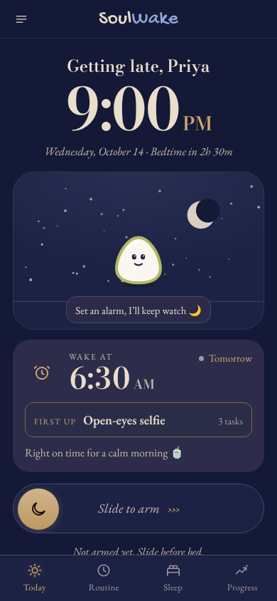 | 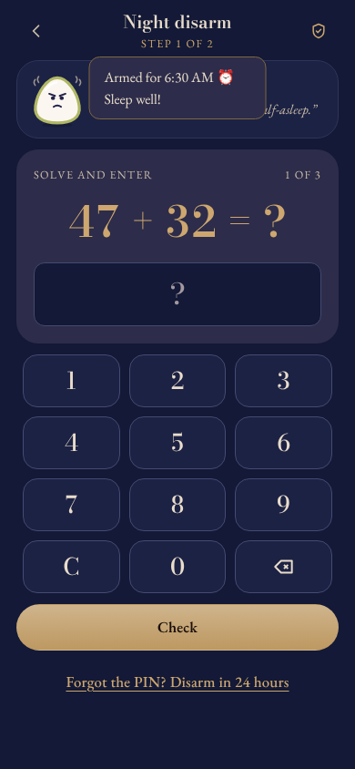 | 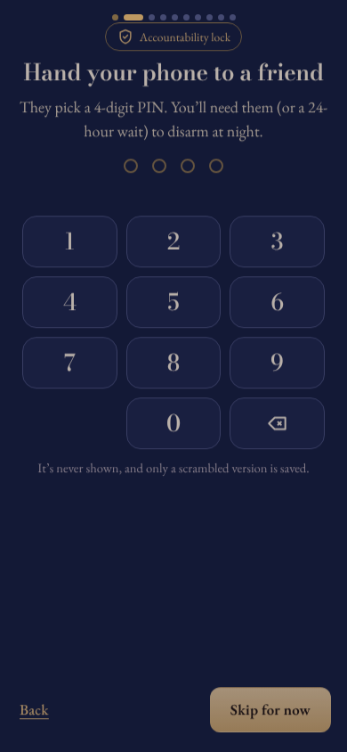 | 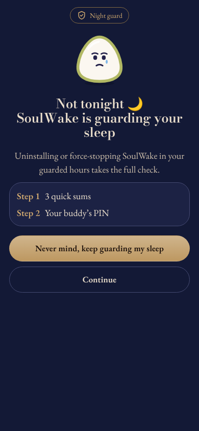 |
| **Routine** | **Sleep** | **Progress** | **☰ Menu** |
| 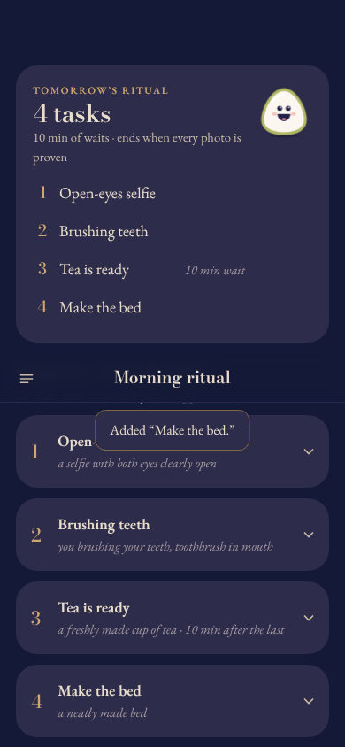 | 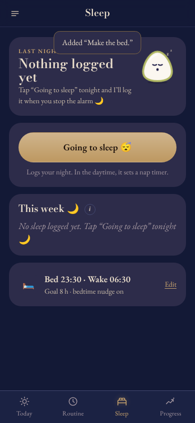 | 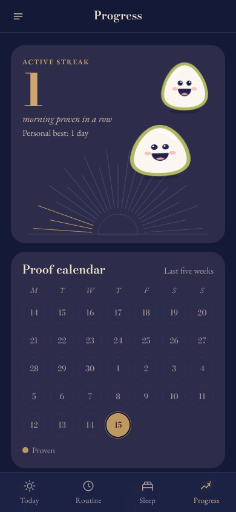 | 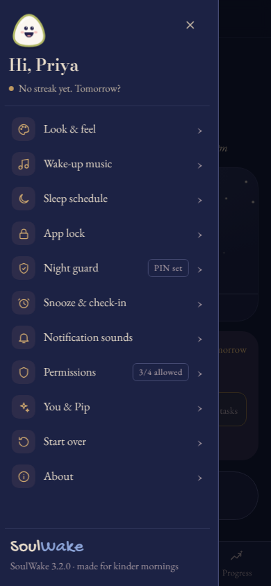 |
| **Ringing** | **Step away** | **Check-in** | **Report card** |
| 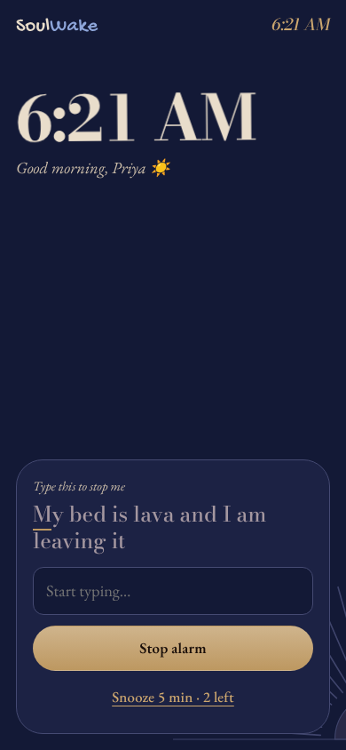 | 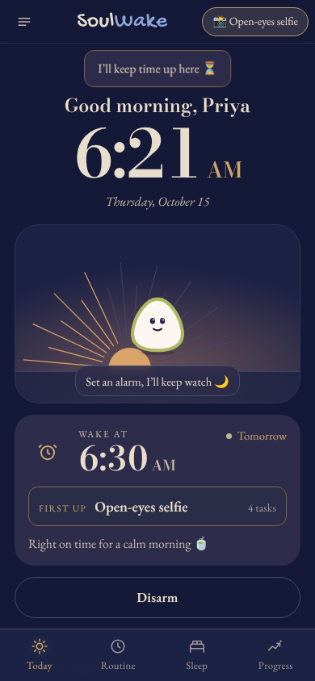 | 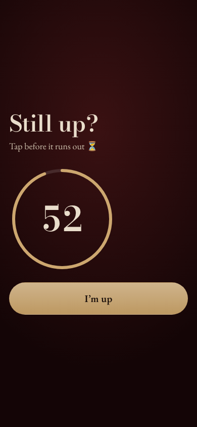 | 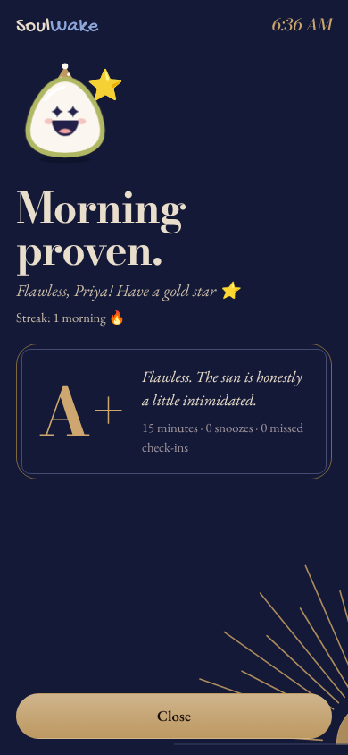 |
| **Kerala city theme** | **Wake-up music** | **Nap timer** | **App lock** |
| 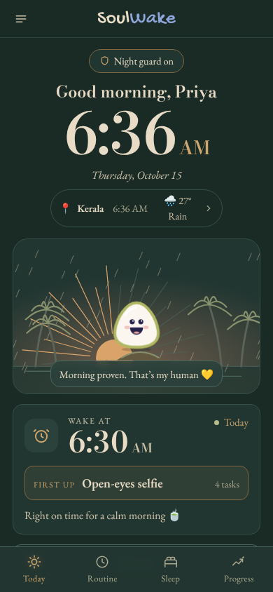 | 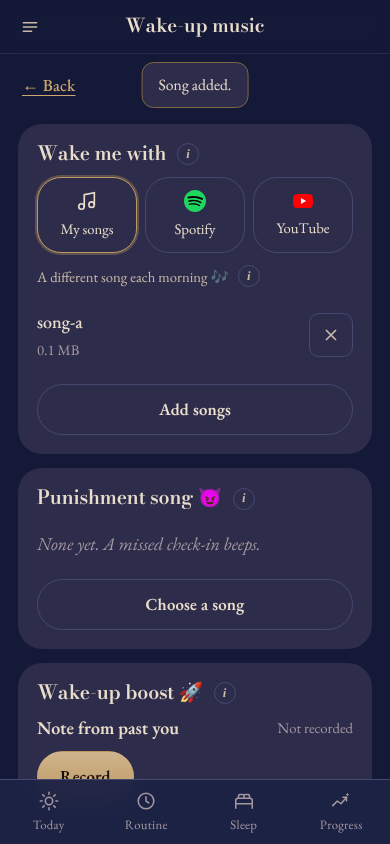 | 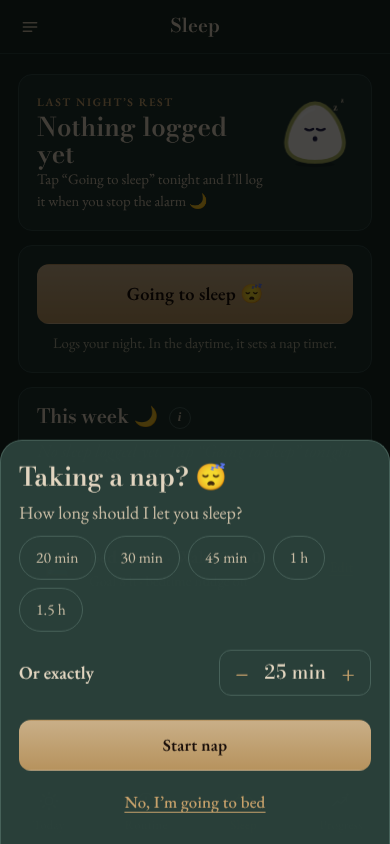 | 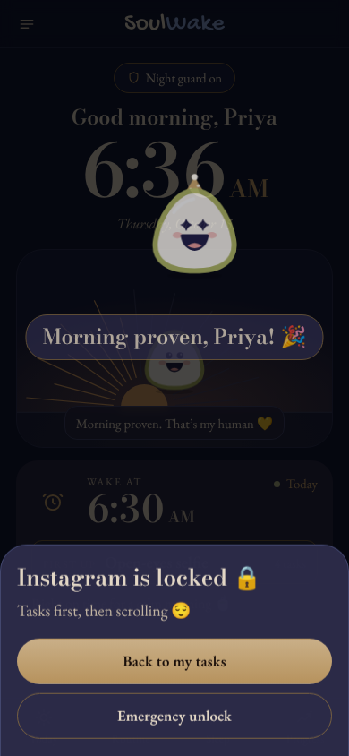 |
| **Setup: themes** | **Look & feel** | **Ivory · Burgundy · Friendly** | **Dusk · Gold · Typewriter** |
| 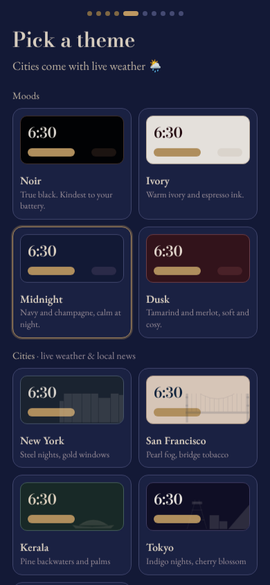 | 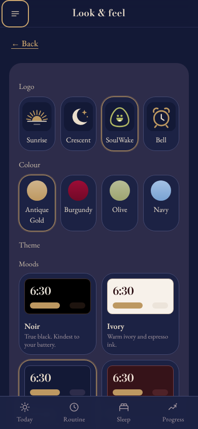 | 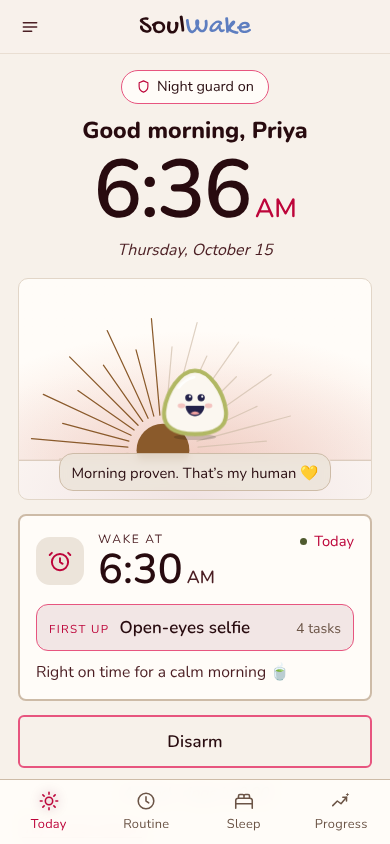 | 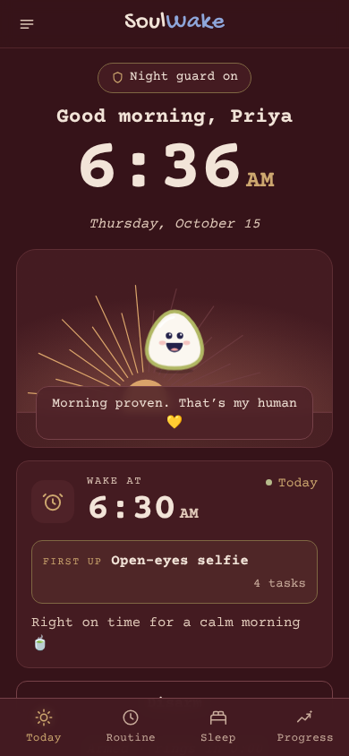 |

## Install

1. Download `soulwake.apk` from the [latest release](https://github.com/YOUR-USERNAME/soulwake/releases/latest), or from the newest run in the [Actions tab](https://github.com/YOUR-USERNAME/soulwake/actions) under **Artifacts**.
2. Open it on your Android phone. Allow installs from that app when asked. If Play Protect warns about an unknown developer, tap **More details → Install anyway**.
3. Open SoulWake and follow Pip’s setup. **Allow the permissions it asks for**, or the alarm can’t ring with the app closed.

<details>
<summary><b>Why each permission is needed</b></summary>

| Permission | Why |
|---|---|
| Notifications | Bedtime nudges, check-ins, and the alarm itself |
| Alarms & reminders | Ring at the exact minute, even in battery-saving sleep |
| Full-screen alarm | Show the alarm over the lock screen |
| Unrestricted battery | Stop some phone makers’ battery savers from delaying alarms |
| Camera / microphone | Proof photos and your voice note. Photos never leave the phone |
| Internet | Streaming music, and city weather/news for city themes |
| Accessibility (optional) | App lock: notices which app opens. Night guard: in your guarded hours only, reads Settings and uninstall screens just to spot SoulWake’s own page. Nothing is stored or sent |

On Android 13+, app lock needs one extra step for apps installed outside the Play Store: **Settings → Apps → SoulWake → ⋮ → Allow restricted settings**.
</details>

> **First night:** tap **Try a test alarm** and lock your phone straight away. It should ring within about 10 seconds. Keep a backup alarm for the first few nights.

## Build it yourself

**On GitHub (no tools needed):** fork or push this repo. The [Build APK](.github/workflows/build-apk.yml) workflow builds an APK on every push to `main`. Find it under **Actions → latest run → Artifacts**. Push a tag like `v3.2.0` to publish it as a Release.

**On your laptop:** you need Node.js 22+ and Android Studio.

```bash
npm install
npx cap sync android      # copy www/ into the Android project
npx cap open android      # open in Android Studio, then press Run
```

**Spotify full-song Connect (maintainers):** create an app at [developer.spotify.com/dashboard](https://developer.spotify.com/dashboard) with a Premium account, add the Redirect URIs `https://firstlight.app/` and `https://firstlight.app/index.html`, tick *Web API* and *Web Playback SDK*, and put its Client ID in `SPOTIFY_CLIENT_ID` in `www/js/config.js` (already set for this repo’s app). The Client ID isn’t secret (sign-in uses PKCE). Spotify allows 5 named accounts per app in Development Mode; add them under *User Management*. Without an ID, the app offers only “share a playlist”.

**Pip and the logos** are drawn in code (`www/js/ui/art.js`), so they recolour with every theme. Launcher icons and splash screens are rendered from the same drawings.

**Photo check:** the runtime (Transformers.js 3.8 + ONNX Runtime WebAssembly) is bundled in `www/vendor/transformers/`. The model (MobileCLIP S0, falling back to CLIP ViT-B/32) downloads from Hugging Face the first time someone switches the check on, then stays cached. Thresholds live in `PHOTO_CHECK` in `www/js/config.js`.

**Renaming note:** the Android app ID (`app.firstlight.alarm`), the WebView address (`firstlight.app`) and the launcher-entry names stay as they were, so updating from First Light keeps everyone’s data and icon. If you rename the app on the Spotify dashboard, keep its Redirect URIs.

All builds are signed with the same key (`android/app/firstlight-debug.keystore`), so a new APK installs over the old one and keeps your data. It’s a personal-use key; use your own release key for a Play Store build.

## How it works

SoulWake is a web app (plain HTML, CSS and JavaScript modules, no build step) wrapped as an Android app with [Capacitor](https://capacitorjs.com). A small native plugin does the parts a web page can’t:

```
 www/ (the app)  ──►  js/services/native.js  ──►  FirstLightPlugin.java
                                                     ├─ AlarmScheduler   setAlarmClock(), survives reboots
                                                     ├─ AlarmService     rings on the alarm stream, full-screen intent
                                                     ├─ Notifier         bedtime / “still awake?” with action buttons
                                                     ├─ LockService      accessibility service: app lock + uninstall guard
                                                     └─ Guard            works out each night’s guarded hours
```

Inside the web app, features never call each other directly. They announce events on a tiny bus (`alarm:fire`, `morning:dismissed`, `checkin:missed`…) and react to each other’s. Each feature owns its own saved data. That keeps the parts loosely coupled: the same code runs as a website (`www/` works on any static host) and inside the APK.

<details>
<summary><b>Project structure</b></summary>

```
www/
  js/core/         event bus, storage, helpers
  js/services/     audio, battery, notifications, native bridge
  js/features/     alarm, morning, checkin, snooze, tasks, sleep, recovery, pet,
                   applock, guard (night guard + buddy PIN), photo-check,
                   music (+ sources/: local, spotify, youtube), stats…
  js/ui/           one file per screen, theme engine, pickers, artwork (logos + Pip)
  css/ fonts/ sounds/ icons/ vendor/ (capacitor, transformers)
android/app/src/main/java/app/firstlight/alarm/   native plugin, services, receivers
.github/workflows/build-apk.yml                   cloud build + releases
tests/             Playwright tests, report, first-time-user walkthrough
docs/screenshots/  images used in this README
```
</details>

## The research behind the tips

The short-sleep plan and the Sunday sleep-in rule are based on published studies:

| Tip | Finding | Source |
|---|---|---|
| Aim for 7–9 h | Recommended range for adults aged 18–25 | Hirshkowitz et al., *Sleep Health*, 2015 |
| Coffee early, none after ~5 pm | Caffeine 6 h before bed cut sleep by over an hour | Drake et al., *J Clin Sleep Med*, 2013 |
| 10 minutes of stairs | Felt more energising than ~50 mg of caffeine in sleep-deprived students | Randolph & O’Connor, *Physiology & Behavior*, 2017 |
| 10-minute nap | The most refreshing nap length after short sleep | Brooks & Lack, *SLEEP*, 2006 |
| Morning daylight | 30 min of bright light reduced negative mood after sleep loss | Kopřivová et al., *Front. Behav. Neurosci.*, 2025 |
| Upbeat music | Fast, happy music boosted alertness | Dovorany et al., *Front. Psychol.*, 2023 |
| ~10 min of social media | Limiting use for 3 weeks lowered loneliness and depression | Hunt et al., *J Soc Clin Psychol*, 2018 |
| Sunday lie-in ≤ 2 h | Weekend catch-up sleep didn’t undo a short week; sleeping till noon shifts the body clock | Depner et al., *Current Biology*, 2019 |

SoulWake measures **time in bed** (from “Going to sleep” to stopping the alarm), not sleep stages. It’s a habit tool, not a medical device.

## Testing

- **187 automated browser tests**, all passing. One test applies all 3,456 look combinations and checks contrast is at least 4.5:1 (WCAG AA) for each; another checks no screen scrolls sideways on a 320 px phone.
- City weather, headlines and Wikipedia are tested with local stand-ins, including offline and gloomy-news cases.
- Android-only behaviour is tested through a fake native bridge that records every call. Spotify and YouTube are tested with local stand-ins.
- The native Java code compiles against the Android 16 (API 36) platform.
- The night guard and photo check have their own tests: guarded hours, sums, wrong PINs, the 24-hour wait, PIN storage (hashed), the uninstall guard through the fake bridge, and the photo check with a stand-in model.
- The real photo-check model can’t be downloaded in the test environment, so its accuracy on real photos is untested here; try it on your phone and adjust `PHOTO_CHECK` if it’s too strict or too lenient.
- A scripted **first-time-user walkthrough** captures every screen from setup to a full morning.

```bash
pip install playwright && playwright install chromium
python3 tests/run_tests.py          # all tests → tests/TEST-REPORT.md
python3 tests/walkthrough.py        # screenshots → tests/walkthrough/
```

## Known limits

- **Android only.** An iPhone version would be a separate build, and iOS doesn’t allow true app locking.
- **Spotify full songs need Premium**, and Spotify limits small apps to 5 named accounts. Everyone else uses shared playlists (30-second previews), which is plenty for an alarm. YouTube’s player must stay visible, and ads may play without YouTube Premium.
- **Instagram reels** play in Instagram’s embed, which needs a tap to start. Reels are never downloaded.
- City weather uses Open-Meteo’s free tier, which is for non-commercial use.
- **Photo check** needs a one-time ~75 MB download and won’t be perfect: odd lighting can fool it. After 3 failed tries you can count a photo anyway (marked unverified).
- **Night guard limits:** Android lets a determined person get round any app (Safe Mode, a computer with ADB, a factory reset). The uninstall guard needs the Accessibility permission and detects Settings screens by their text, so very unusual phone skins may slip through. It’s built to stop half-asleep you, not a hacker.
- Not on the Play Store. App lock uses an accessibility service, which Google reviews strictly.

## Credits

Built with [Capacitor](https://capacitorjs.com). Fonts: Gochi Hand (the wordmark), Bodoni Moda, EB Garamond, DM Serif Display, DM Sans, Nunito, Courier Prime, Space Grotesk, JetBrains Mono, Fredoka, Cinzel, Cormorant Garamond, Limelight and Josefin Sans (SIL Open Font License, see `www/fonts/`). Weather by [Open-Meteo](https://open-meteo.com) (CC BY 4.0), headlines via the [GDELT Project](https://www.gdeltproject.org), facts from [Wikipedia](https://www.wikipedia.org) (CC BY-SA). Brand marks from [Simple Icons](https://simpleicons.org) (CC0); Spotify, YouTube and Instagram are trademarks of their owners and are used only to link to their content. Skylines are original drawings; the SoulWake logo is the owner’s; Pip is drawn from it. Photo check: [Transformers.js](https://github.com/huggingface/transformers.js) (Apache-2.0), ONNX Runtime Web (MIT), MobileCLIP (Apple, via Hugging Face). Alarm and notification sounds were synthesised for this project.
